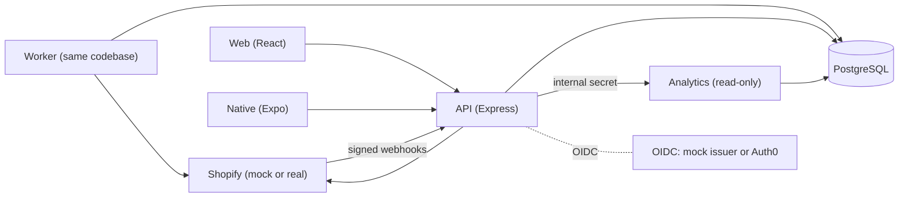

# OrderFlow AI

An internal order-operations system for Hannan's decoration-piece business. Authorized staff see Shopify orders that are genuinely paid, prepare each parcel through a five-step checklist, dispatch it safely, record delivery once and permanently, track manual refund applications, and read an order timeline and two reports.

> **Status:** planning complete, implementation starts at slice S0. Sections marked *(from S0)* describe commands that exist once the foundation slice is accepted. See [`plan.md`](plan.md) for the current slice status.

This is a demo-ready student project (semester final project, deliverable D4). It is **not** a production-certified order-management platform. See [Known limitations](#known-limitations).

---

## 1. What it does

| Capability | Summary |
|---|---|
| Order intake | Receives signed Shopify webhooks, verifies them, stores them durably, and processes them in a background worker. Always re-fetches the current order from Shopify; the webhook body is only a hint |
| Eligibility | Only paid, uncancelled, unfulfilled, non-test, non-COD, PKR orders whose payments add up to the total enter the active queue. Refunded or voided orders are blocked |
| Order list | Filters (Pending, Dispatched, Completed, Needs attention), search by order number, customer name or tracking number |
| Order detail | Products, quantities, customer, delivery address (shown only with permission), pre-dispatch address override, timeline |
| Packing checklist | Five steps, completed in order; only the latest step can be undone, and only before dispatch |
| Safe dispatch | Explicit confirmation, tracking number, server-side checks, a live Shopify check, and a durable attempt. A timeout becomes "pending confirmation" and is reconciled, never blindly retried, so no duplicate fulfillment is created |
| Delivery | Recorded once by an authorized user, with actor and time. It cannot be reversed; a correction is a separate note |
| Conflicts | A Shopify cancellation or fulfillment change after dispatch raises a conflict flag; the order's own history is never rewritten |
| Refund applications | Staff record manual refund applications with product snapshots; Owner or Admin reviews them. **OrderFlow never calculates or issues a refund** |
| Reports | Dispatch performance (payment verified to confirmed dispatch, `Asia/Karachi`) and refund applicants, served by a separate read-only analytics process |
| Audit | One insert-only audit trail with no personal data in it; it also drives the order timeline |
| Clients | Responsive web app (administration, reports, integration health) and Expo native app (core staff workflow) on the same API |

## 2. Architecture at a glance



Processes: `api`, `worker`, `analytics`, `web`, `mock-oidc`, `postgres`; the native app runs on the host.
Full detail: [`docs/architecture.md`](docs/architecture.md) (design, data flows, ADR-001 to ADR-009).

**Stack:** TypeScript (strict) everywhere; Node and Express; Zod; PostgreSQL with Prisma; React, Vite and TanStack Query; React Native with Expo; OIDC through `jose`; Vitest, Supertest, jest-expo and Playwright; Docker Compose; npm workspaces.

## 3. Repository map

```text
PRD.md                   product requirements (source of truth, v3.0)
README.md                this file
AGENTS.md                rules for AI coding agents
plan.md                  master plan (with dated change log)
docs/
  architecture.md        architecture and ADRs
  adr/                   one file per ADR
  plan-history/          plan-v01.md, plan-v02.md, ...
  evidence/              workflow-log, test-evidence, contribution-log, ai-sessions
  wireframes/            UI wireframes
  final-report.md        final project report with CCP analysis
  demo-script.md         step-by-step demo
  proposed-changes.md    suggestions from agents awaiting a human decision
api-spec/openapi.yaml    API contract
fixtures/shopify/        signed-webhook payloads and GraphQL fixtures
scripts/                 webhook simulator, seed, reset, mock scenarios
packages/shared/         schemas, generated API types, enums, permission keys
apps/api  apps/analytics  apps/mock-oidc  apps/web  apps/native
```

## 4. Prerequisites

| Tool | Notes |
|---|---|
| Node.js | The current LTS version pinned in `.nvmrc` |
| npm | Comes with Node (npm workspaces) |
| Docker and Docker Compose | Runs PostgreSQL, API, worker, web, analytics and the mock identity provider |
| Expo Go or an emulator | For the native app *(decide which; see plan.md open item O-04)* |

No external accounts or credentials are needed for the demo path.

## 5. Quick start (mock mode, the guaranteed demo path) *(from S0)*

```bash
cp .env.example .env            # demo values only, no real secrets
npm install
docker compose up --build       # postgres, api, worker, web, analytics, mock-oidc
npm run db:migrate              # if not already applied by the api container
ALLOW_DESTRUCTIVE_SEED=true npm run db:seed   # synthetic demo data
```

Then open the web app (the URL is printed by Compose and listed in `.env.example`) and sign in with a demo account.

| Demo account | Role | Can do |
|---|---|---|
| `owner` | Owner | Everything, including granting the Owner role |
| `admin` | Admin | Everything except granting Owner |
| `staff` | Staff | View orders and addresses, checklist, refund applications |
| `staff.dispatch` | Staff plus dispatch capability | Also dispatch |
| `staff.delivery` | Staff plus delivery capability | Also record delivery |

The exact usernames and passwords are the fixed demo users of the mock identity provider, listed in `.env.example` and `apps/mock-oidc`. They are synthetic. A user who signs in but has no roles can see nothing.

### Native app

```bash
npm run native:start            # Expo dev server; connect with Expo Go or an emulator
```

On a physical phone, `localhost` means the phone. Set `API_PUBLIC_URL` to your computer's LAN address, and make sure the issuer address is reachable from the phone too.

## 6. Commands

| Task | Command |
|---|---|
| Install dependencies | `npm install` |
| Start the whole stack | `docker compose up --build` |
| Stop it | `docker compose down` |
| Run migrations | `npm run db:migrate` |
| Seed demo data (destructive, guarded) | `npm run db:seed` |
| Reset demo data (destructive, guarded) | `npm run db:reset` |
| Send a signed test webhook | `npm run webhook:simulate -- --topic orders/paid --fixture <name>` |
| Switch a mock scenario (outage, timeout) | `npm run mock:scenario -- --set <scenario>=<on\|off>` |
| Unit and integration tests | `npm test` |
| Web end-to-end smoke tests | `npm run test:e2e` |
| Lint | `npm run lint` |
| Type check | `npm run typecheck` |
| Format check | `npm run format:check` |
| Start the native app | `npm run native:start` |

Before any pull request, `npm run lint`, `npm run typecheck`, `npm run format:check` and `npm test` must all pass.

**Seed and reset are destructive.** They require `ALLOW_DESTRUCTIVE_SEED=true`, print what they will delete, and refuse to run when `SHOPIFY_ADAPTER=real`.

## 7. Mock mode and real Shopify mode

| | Mock (default) | Real (optional) |
|---|---|---|
| Setting | `SHOPIFY_ADAPTER=mock` | `SHOPIFY_ADAPTER=real` |
| Needs | nothing external | A Shopify development store, Admin API token, app secret, pinned `SHOPIFY_API_VERSION` |
| Webhooks | Signed fixtures sent by `npm run webhook:simulate` | Real store webhooks sent to a public HTTPS address |
| Customer notification | Always off | Off unless `SHOPIFY_NOTIFY_CUSTOMER=true` |
| Use for | Demo, tests, acceptance | Configuration demonstration only |

To switch, edit `.env` and restart `api` and `worker`. Business logic and endpoints are identical in both modes.

In mock mode, `npm run mock:scenario` changes how the simulated Shopify behaves (outage, timeout after creating the fulfillment, and so on) for both the API and the worker, so every failure path can be shown on demand.

## 8. Configuration

All settings are environment variables; `.env.example` holds placeholders and demo values only. Never commit real secrets.

| Variable | Purpose | Default |
|---|---|---|
| `DATABASE_URL`, `DATABASE_URL_READONLY` | Application and analytics database connections | none |
| `INTERNAL_SERVICE_SECRET`, `ANALYTICS_URL` | API to analytics | none |
| `SHOPIFY_ADAPTER` | `mock` or `real` | `mock` |
| `SHOPIFY_SHOP_DOMAIN`, `SHOPIFY_APP_SECRET` | Webhook shop check and signature secret (needed in both modes) | demo values |
| `SHOPIFY_API_VERSION`, `SHOPIFY_ADMIN_TOKEN` | Real mode only | none |
| `SHOPIFY_NOTIFY_CUSTOMER` | Send a shipping notification | `false` |
| `OIDC_ISSUER`, `OIDC_JWKS_URI`, `OIDC_CLIENT_ID`, `OIDC_AUDIENCE`, `OIDC_REDIRECT_URIS` | Identity provider settings | mock issuer |
| `BOOTSTRAP_OWNER_SUBJECT` | Identity that receives the Owner role at seed time | demo value |
| `SESSION_SECRET`, `CORS_ORIGINS` | Web session and allowed origins | none |
| `REPORT_TZ` | Report date interpretation | `Asia/Karachi` |
| `STALE_AFTER_MINUTES` | Data older than this is labelled stale | `15` |
| `ALLOW_DESTRUCTIVE_SEED` | Enables seed and reset | `false` |

The full list is in `docs/architecture.md` section 16.2.

## 9. Testing

Testing is intentionally lightweight and supports development. For every slice the team runs the relevant checks and compares the result with the acceptance criteria before accepting it.

- **Kinds:** functional, negative, equivalence partitioning and boundary value analysis where they are meaningful (for example tracking-number lengths 5, 6, 30 and 31).
- **Levels:** unit, integration (PostgreSQL, API, webhook inbox, adapter), web end-to-end smoke, security, and performance with 100 seeded active orders.
- **Mandatory scenarios:** the 25 scenarios of PRD section 15.2.
- **Quality gates:** five gates (slice readiness, functional verification, architecture check, regression and integration check, final product check). See `plan.md` section 11.
- **Evidence:** `docs/evidence/test-evidence.md` (slice, test type, input, expected, actual, pass or fail).

```bash
npm test            # unit and integration
npm run test:e2e    # web smoke
```

## 10. Development process

Built with the AI-native, slice-by-slice workflow required by the course (deliverable D4).

1. Work is divided into **vertical slices** (S0 to S6), each delivering a complete user-visible capability across UI, API, domain, data and tests. See `plan.md`.
2. Every slice follows the same loop: select, load context, refine criteria and tests, choose HITL or AFK, AI implements, run checks, human decides Accept, Revise or Reject, integrate, update the plan.
3. **Plan history:** every meaningful change to `plan.md` is saved as `docs/plan-history/plan-vNN.md` and logged in the plan's change log.
4. **Evidence:** `docs/evidence/workflow-log.md`, `test-evidence.md`, `contribution-log.md` and saved AI sessions, kept as the work happens.
5. AI-generated code is not accepted automatically. Authentication, payment eligibility and dispatch always get human review before merge.
6. One branch per slice, small commits, review before merging to `main`. Rules for AI agents are in `AGENTS.md`.

**Team:** Ibrahim (planning, process and client UI), Ihtesham (architecture, documentation, scaffold, mock adapter, analytics), Taha (backend), Ahmed (QA and testing).

## 11. Demo script outline

The detailed script is `docs/demo-script.md`. Outline:

1. Start the stack; show `/health` and the sign-in with the demo identity provider.
2. Send a signed paid-order webhook; the order appears in the list. Send a duplicate (no second effect), a tampered one (rejected), and an unpaid or refunded one (blocked).
3. Open the order; complete the five checklist steps in order; try to skip one; undo the latest.
4. Dispatch with the confirmation dialog. Repeat the request (stored outcome returned). Switch the mock to timeout and dispatch another order: it goes to pending confirmation and reconciles with no duplicate fulfillment. Switch to outage: dispatch is blocked.
5. Record delivery; show it cannot be reversed. Cancel a dispatched order in the mock: the conflict flag appears and the lifecycle does not regress.
6. Submit a refund application as staff; review it as Admin; show that no refund is issued.
7. Show both reports and the order timeline. Show a role restriction and that the analytics role cannot write.
8. Show the evidence: plan versions, workflow log, a revised or rejected AI output, test evidence, contribution log.

## 12. Security and privacy

- Webhooks are verified by HMAC over the raw body, checked against the shop domain, and deduplicated by delivery ID.
- Permissions are checked by the API on every request; hiding a button is never authorization.
- Delivery addresses and contact data are visible only with the right permission and never appear in logs or audit events.
- Secrets live only in environment variables and are never committed.
- All demo data is synthetic. Do not load real customer data.

## 13. Known limitations

- The mock identity provider is not a production identity service; Auth0 is the documented production option.
- Mock Shopify mode is the guaranteed path. Real mode needs external credentials and cannot accept test transactions, so it is a configuration demonstration unless the team confirms otherwise.
- A refunded, voided or partially refunded order stays blocked until Shopify's own state makes it eligible again; there is no in-app override.
- Dispatch fulfils every line item; partial fulfilment is not supported.
- Single store, single currency (PKR), no inventory, no courier integration, no offline mode.
- No certified backup or restore, no production hosting, high availability or security audit. Performance numbers are demo targets measured locally.
- Anything dropped for time is listed in `plan.md` and added here before submission.

Before production use the business would need, at least: a real identity provider tenant, Shopify app review and live scopes, production hosting and secrets management, backup and restore testing, a retention policy, a security assessment, and verification of notification and fulfillment behaviour in the actual store.

## 14. Documents

| Document | Purpose |
|---|---|
| [`PRD.md`](PRD.md) | Requirements (wins any conflict) |
| [`docs/architecture.md`](docs/architecture.md) | Design and decisions |
| [`api-spec/openapi.yaml`](api-spec/openapi.yaml) | API contract |
| [`AGENTS.md`](AGENTS.md) | Rules for AI coding agents |
| [`plan.md`](plan.md) | Master plan and slice status |
| [`docs/evidence/`](docs/evidence/) | Workflow log, test evidence, contribution log, AI sessions |
| [`docs/final-report.md`](docs/final-report.md) | Final report including the complex computing problem analysis |

If the code and a document disagree, that is a defect: fix the one that is wrong and record the change.
