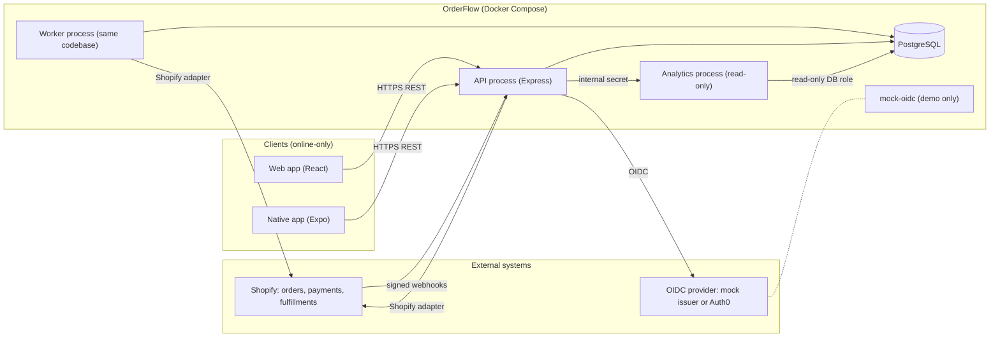
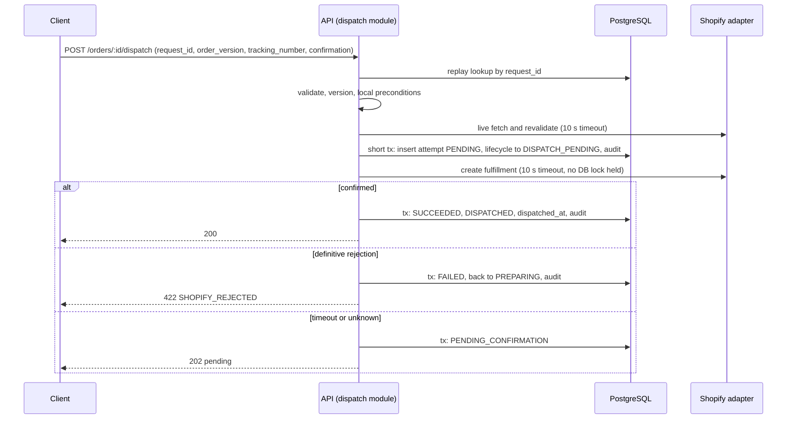

# ARCHITECTURE.md: OrderFlow AI

**Version:** 2.1 | **Date:** 23 November 2026 | **Aligned to:** PRD v3.0 | **Supersedes:** Final Architecture and MVP Plan v1.2 (14 Nov 2026)
**Commit path:** `docs/architecture.md` (PRD section 19.2)

---

## 0. Document control

### 0.1 Precedence

1. `PRD.md` v3.0
2. This document, including the ADRs in section 17
3. `api-spec/openapi.yaml`
4. `AGENTS.md`
5. README, `plan.md`, other documents

A lower document that conflicts with a higher one is wrong; record it in `docs/proposed-changes.md`. Humans amend through section 21.

### 0.2 Labels

Same as the PRD: **Confirmed**, **Resolved default**, **Demo limitation**, **Out of scope**. One addition: **Verify** means the detail must be checked against Shopify's documentation for the pinned API version before implementation.

MUST, MUST NOT and SHOULD are normative.

---

## 1. Purpose and scope

OrderFlow AI is an internal order-operations system for one business (Hannan's decoration pieces). Authorized staff see Shopify orders that are eligible for handling, prepare each parcel through a five-step checklist, dispatch it safely, record delivery, review manual refund applications, and read an order timeline and two reports.

**In scope:** everything in PRD sections 4, 5 and 11.
**Out of scope:** everything in PRD section 1.5. In particular, this architecture contains no storefront, no payment collection, no courier integration, no customer-support or chat module, no automated refunds, no offline mode, no inventory, and no multi-tenancy.

---

## 2. Locked decisions

Locked means an AI agent MUST NOT change it. Humans change it only through section 21.

| ID | Decision | Status in v2.0 |
|---|---|---|
| D-01 | Modular layered backend (API layer, domain layer, data-access layer) with one separate read-only analytics process. Clients use MVC. No other service extraction. | Retained. The worker is a second entrypoint of the same backend codebase, not a new service. |
| D-02 | Clients are online-only. No local order database, no offline queue. | Retained, with one explicit exception: auth tokens in platform secure storage (PRD 2.3). |
| D-03 | Authentication is delegated to an OIDC provider. Authorization is a central server-side permission map. | Retained. Provider options narrowed to mock issuer and Auth0. |
| D-04 | Every external system sits behind an adapter interface. | Retained for Shopify and OIDC. The courier adapter is removed (PRD non-goal). |
| D-05 | Dispatch safety: unique request ID, optimistic `order_version`, one active attempt per order. | Retained. The "pessimistic lock around the Shopify call" part is replaced (see ADR-005). |

D-03 and D-04 were never written down in earlier documents; the wording above is now their definition.

Earlier resolutions R-01 to R-11 are folded into this document. Four changed: R-03 (Firebase dropped; mock issuer or Auth0 only), R-05 (the deferred courier webhook is now removed entirely), R-07 (the storefront gateway is not checked by default) and R-11 (report time zone is fixed by the PRD to `Asia/Karachi`, set by configuration, not by request). The rest stand as written.

---

## 3. System context and boundaries



### 3.1 Runtime processes

| Process | Package | Responsibility | Network exposure |
|---|---|---|---|
| `api` | `apps/api` (entry `src/server.ts`) | REST API, webhook receiver, web auth endpoints | Published |
| `worker` | `apps/api` (entry `src/worker.ts`) | Webhook processing, retries, 5-minute reconciliation, dispatch reconciliation, heartbeat | None |
| `analytics` | `apps/analytics` | Dispatch-performance and refund-applicant reports | Internal network only |
| `web` | `apps/web` | Responsive web client | Published |
| `native` | `apps/native` | Expo staff app, run on host | Connects to `api` |
| `mock-oidc` | `apps/mock-oidc` | Demo identity provider | Published (demo only) |
| `postgres` | image | Database | Internal network only |

### 3.2 Trust boundaries

1. Client to API: untrusted. Every protected request is authenticated and authorized by the API.
2. Shopify to API: untrusted until the HMAC over the raw body verifies and the shop domain matches `SHOPIFY_SHOP_DOMAIN`. Even then the webhook body is only a hint (see 10.1).
3. API to analytics: trusted only with the `INTERNAL_SERVICE_SECRET` header.
4. Analytics to database: read-only role, column-restricted (section 8.5).

---

## 4. Technology stack (ADR-008)

| Area | Decision |
|---|---|
| Language | TypeScript, strict mode, everywhere |
| Monorepo | npm workspaces (`apps/*`, `packages/*`) |
| Backend | Node.js (current LTS, pinned in `.nvmrc`) + Express |
| Validation | Zod at every API boundary; schemas live in `packages/shared` |
| Database | PostgreSQL |
| Data access | Prisma (schema, typed client, migrations). Constraints Prisma cannot express (partial unique indexes, triggers, grants) are written as custom SQL inside Prisma migrations. |
| Money | `NUMERIC(12,2)`; `Prisma.Decimal` in code; amounts travel as decimal strings in JSON; never `number` |
| API contract | REST under `/api/v1`, contract-first `api-spec/openapi.yaml`; shared types generated from it; contract tests validate responses |
| OIDC (server) | `jose` for JWT and JWKS validation; authorization-code + PKCE for clients |
| Mock issuer | `oidc-provider` inside `apps/mock-oidc`, seeded users |
| Logging | `pino`, JSON, with a redaction list (section 14) |
| HTTP hardening and contract | `helmet`, `cors`, `express-rate-limit`, `cookie-parser`; `pg` for analytics; `openapi-typescript` and `express-openapi-validator` (tests only) |
| Web client | React + Vite + React Router + TanStack Query |
| Native client | React Native + Expo + TypeScript, `expo-secure-store` for tokens |
| Unit/integration tests | Vitest (backend, web, shared, analytics); Supertest for API; `jest-expo` for native components |
| E2E | Playwright (web smoke) |
| Local environment | Docker Compose |

Adding any dependency outside this table requires human approval (AGENTS.md section 4). Exact versions are pinned by lockfile; floating versions are not allowed in the final submission.

---

## 5. Repository layout

```text
/
├── PRD.md
├── README.md
├── AGENTS.md
├── plan.md                      single master plan with dated change log
├── docker-compose.yml
├── .env.example                 placeholders only
├── package.json                 npm workspaces root
├── docs/
│   ├── architecture.md          this file
│   ├── adr/                     ADR-001 to ADR-009 (from section 17)
│   ├── proposed-changes.md
│   └── evidence/                workflow-log, test-evidence, contribution-log, ai-sessions
├── api-spec/openapi.yaml
├── fixtures/shopify/            signed-webhook payloads and GraphQL response fixtures
├── scripts/                     simulate-webhook.ts, seed.ts, reset-demo.ts
├── packages/
│   └── shared/                  Zod schemas, generated API types, enums, permission keys
└── apps/
    ├── api/
    │   ├── prisma/              schema.prisma, migrations/ (including custom SQL)
    │   └── src/
    │       ├── http/            routes, middleware, error mapper (API layer)
    │       ├── modules/         domain + data-access per capability (section 6)
    │       ├── integrations/shopify/   adapter interface, mock/, real/, hmac, mappers
    │       ├── db/              Prisma client, transaction helper
    │       ├── config/          env parsing (Zod), constants
    │       ├── server.ts
    │       └── worker.ts
    ├── analytics/
    ├── mock-oidc/
    ├── web/
    └── native/
```

---

## 6. Backend structure

### 6.1 Layers (D-01)

| Layer | Location | May do | MUST NOT |
|---|---|---|---|
| API | `src/http/**` | Parse and validate requests, authenticate, authorize, call one domain service, format the response | Contain business rules; touch Prisma directly |
| Domain | `src/modules/*/service.ts` | Business rules, state transitions, orchestration, calling adapters | Import Express types; import another module's internals (use its `index.ts`) |
| Data access | `src/modules/*/repo.ts`, `src/db/**` | Prisma queries and transactions | Contain business decisions |

### 6.2 Modules

| Module | Owns | Writes | MUST NOT |
|---|---|---|---|
| `auth` | Token validation, user resolution, permission map, role administration | `users`, `user_roles` | Change order state |
| `orders-query` | List, search, detail, timeline reads, permission-filtered | nothing | Write |
| `lifecycle` | **The only writer of** `orders.lifecycle_status`, `order_version`, `payment_verified_at`, `dispatched_at`, `delivered_at`, `delivered_by` | those columns | Accept a transition not in section 9 |
| `checklist` | Five-step rules | `checklist_steps` (state changes go through `lifecycle` for `PREPARING` and version) | Edit steps after dispatch is requested |
| `dispatch` | Dispatch validation, attempts, idempotency, reconciliation | `dispatches` | Change lifecycle directly (calls `lifecycle`) |
| `delivery` | Delivery confirmation and correction notes | `dispatches.delivery_note`, `order_notes` | Reverse or edit delivered state |
| `refunds` | Manual refund applications and review | `refund_applications`, `refund_application_items` | Call any Shopify refund operation (none exists in the adapter) |
| `sync` | Shopify snapshot refresh, eligibility evaluation, conflict detection | Shopify-derived columns of `orders`, `order_items`, `eligibility_*`, `shopify_conflict_*` | Write lifecycle columns (calls `lifecycle`) |
| `webhooks-inbox` | Receiver logic, inbox, retry scheduling, dead letters | `webhook_inbox` | Process synchronously in the request |
| `audit` | Append-only events, allowlisted details | `audit_events` (insert only) | Store PII or secrets |
| `admin` | Integration status, dead-letter requeue, audit read | `webhook_inbox.status` (requeue only) | n/a |
| `reports-gateway` | Authorizes and proxies report requests to analytics | nothing | Query report data itself |

### 6.3 Shopify adapter isolation

Shopify-specific code stays inside `integrations/shopify/`; domain modules see domain objects only.

---

## 7. Client structure

Web and native share API contracts, status labels, permission keys, validation schemas and lifecycle enums through `packages/shared`. No business rule exists only in a client.

**MVC for both clients (D-01):**

| Part | Content |
|---|---|
| Model | Typed in-memory server state (TanStack Query cache on web, equivalent on native) and DTO types from `packages/shared` |
| Controller | Hooks/modules that call the API, manage loading, pending and error states, and translate API errors into view states |
| View | Presentational components. No fetch calls, no business rules |

**Rules (D-02):** no local database, no persisted order data, no offline queue. After restart the client refetches. Tokens only in `expo-secure-store` (native) or an HTTP-only secure session cookie (web). Never `localStorage` for tokens.

**Required view states** for every server-dependent screen: `synchronized`, `pending-confirmation`, `failed`, plus a visible **stale** or **Shopify unavailable** banner. A success state is shown only after the API returns it. After a dispatch call returns 202, the client polls `GET /orders/:id/dispatch-status` every 3 seconds for up to 60 seconds, then shows "still pending, check again" with a manual refresh.

**Platform split (PRD 4):** web carries administration, reports and integration health; native carries the core staff workflow (sign-in, list, detail, checklist, dispatch, delivery, timeline, refund status).

---

## 8. Data architecture

### 8.1 Authority

| Data | Authority |
|---|---|
| Order identity, number, line items, quantities, titles, prices, currency, customer and address as received | Shopify |
| Payment and financial status, transactions, refunds | Shopify |
| Fulfillment ID and state | Shopify |
| Checklist, lifecycle, dispatch attempts, delivery record, address override, notes | OrderFlow |
| Users, roles, permissions | OrderFlow |
| Refund applications and manual review | OrderFlow |
| Audit and timeline | OrderFlow |
| Reports | Derived, read-only |

OrderFlow MUST NOT overwrite Shopify financial facts. Shopify-derived columns (the **Shopify snapshot**) are rebuildable from Shopify. OrderFlow-owned tables are not rebuildable and are not certified for backup (PRD 18).

### 8.2 Tables

Types: `uuid` primary keys unless noted; timestamps are `TIMESTAMPTZ` in UTC; money is `NUMERIC(12,2)` with a currency column.

**`orders`**

| Group | Columns |
|---|---|
| Identity | `id`, `shopify_order_id` (unique), `shopify_order_number` |
| Shopify snapshot (written only by `sync`) | `customer_name`, `customer_email`, `customer_phone` (nullable), `shopify_shipping_address` (jsonb, protected), `currency`, `subtotal_amount`, `shipping_amount`, `total_amount`, `shopify_financial_status`, `shopify_fulfillment_status`, `shopify_cancelled_at`, `shopify_updated_at`, `last_synced_at` |
| Eligibility (written only by `sync`) | `eligibility_status` (`PENDING_VERIFICATION`, `ELIGIBLE`, `INELIGIBLE`), `eligibility_reason_code` (nullable) |
| OrderFlow lifecycle (written only by `lifecycle`) | `lifecycle_status`, `order_version` (starts at 1), `payment_verified_at`, `dispatched_at`, `delivered_at`, `delivered_by` |
| Operational address override | `address_override` (jsonb, nullable), `address_override_by`, `address_override_at`, `address_override_reason` (max 200 chars) |
| Conflict | `shopify_conflict_flag` (bool), `shopify_conflict_reviewed_at` (nullable) |
| Housekeeping | `created_at`, `updated_at` |

**`order_items`**: `id`, `order_id`, `shopify_line_item_id`, `product_id`, `variant_id`, `product_title`, `variant_title`, `sku`, `quantity`, `unit_price`, `line_total`. Shopify snapshot; replaced by `sync`.

**`checklist_steps`**: `id`, `order_id`, `step_number` (CHECK 1 to 5), `step_key`, `label`, `is_completed`, `completed_at`, `completed_by`, `updated_at`. Unique `(order_id, step_number)`. All five rows are created when the order is first stored.

**`dispatches`**: `id`, `order_id`, `request_id` (unique), `request_hash` (hash of the canonical payload, for idempotency), `status` (`PENDING`, `PENDING_CONFIRMATION`, `SUCCEEDED`, `FAILED`), `tracking_number`, `shopify_fulfillment_id` (unique when present), `attempt_count` (number of reconciliation checks made for this attempt), `last_error_code`, `last_error_message` (sanitized), `requested_by`, `requested_at`, `confirmed_at`, `last_checked_at`, `negative_check_count`, `precheck_fulfillment_ids` (jsonb: fulfillment IDs seen in the step-5 live fetch), `delivery_note` (max 200 chars; PRD places it here).

**`webhook_inbox`**: `id`, `shopify_webhook_id` (unique), `shopify_event_id` (nullable), `topic`, `shop_domain`, `api_version`, `shopify_triggered_at`, `resource_id` (nullable Shopify order ID), `payload` (protected), `status` (`RECEIVED`, `PROCESSING`, `PROCESSED`, `FAILED`, `DEAD_LETTER`), `attempt_count`, `received_at`, `processed_at`, `next_retry_at`, `locked_until`, `last_error_code`, `last_error_message`.

**`refund_applications`**: `id`, `order_id`, `application_number`, `application_type` (`APPLICATION`, `INQUIRY`), `status`, `reason_code`, `customer_reason`, `requested_at`, `submitted_by`, `request_id` (unique), `request_hash`, `reviewed_by`, `reviewed_at`, `review_note`, `manual_delivery_charge_amount`, `manual_approved_amount`, `currency`, `created_at`, `updated_at`.

**`refund_application_items`**: `id`, `refund_application_id`, `order_item_id` (nullable), `product_title_snapshot`, `variant_title_snapshot`, `sku_snapshot`, `requested_quantity`, `reason_note`.

**`order_notes`** (append-only): `id`, `order_id`, `kind` (`EXCEPTION`, `CONFLICT_REVIEW`, `DELIVERY_CORRECTION`), `note` (max 500 chars), `created_by`, `created_at`. The timeline event stores the note ID, not the text.

**`audit_events`** (insert-only): `id`, `order_id` (nullable), `actor_type` (`USER`, `SYSTEM`, `SHOPIFY`), `actor_id` (nullable), `event_type`, `details` (allowlisted JSON), `request_id` (nullable), `created_at`. The order timeline is the query `WHERE order_id = ? ORDER BY created_at, id` over this table. There is no separate status-history table.

**Identity:** `users` (`id`, `oidc_subject` unique, `email`, `display_name`, `is_active`, timestamps), `roles`, `permissions`, `user_roles`, `role_permissions`.

**Operations:** `integration_state` (`key`, `value` jsonb, `updated_at`: last successful Shopify call, last reconciliation) and `worker_heartbeats` (`worker_name`, `last_seen_at`). In mock mode only, `mock_shopify_orders` (`shopify_order_id`, `data` jsonb, `updated_at`) and `mock_controls` (`key`, `value`) hold the simulated Shopify's state and scenario switches, so the API and worker processes see the same mock.

### 8.3 Constraints enforced in the database

1. Unique: `shopify_order_id`, `shopify_webhook_id`, `dispatches.request_id`, `refund_applications.request_id`, `(order_id, step_number)`, `shopify_fulfillment_id` when present.
2. Partial unique index: one active dispatch per order: `UNIQUE (order_id) WHERE status IN ('PENDING','PENDING_CONFIRMATION')`.
3. Partial unique index: one successful dispatch per order: `UNIQUE (order_id) WHERE status = 'SUCCEEDED'`.
4. Trigger on `orders`: `payment_verified_at`, `dispatched_at`, `delivered_at`, `delivered_by` cannot change once non-null.
5. Trigger on `orders`: `lifecycle_status` cannot leave `DELIVERED` or `CANCELLED`, and cannot go from `DISPATCHED` or `DELIVERED` to `CANCELLED`.
6. Trigger on `audit_events` and `order_notes`: reject UPDATE and DELETE.
7. Foreign keys protect every relationship in section 8.2.
8. CHECK constraints on enums, amounts `>= 0`, tracking-number pattern `^[A-Za-z0-9-]{6,30}$`.

### 8.4 Concurrency and transactions

- Every state-changing client request carries `order_version`. Updates use `UPDATE ... WHERE id = ? AND order_version = ?` and treat zero rows as stale (HTTP 409).
- `order_version` increments on: any lifecycle transition (including ones triggered by Shopify sync, such as `PAID` or `CANCELLED`), checklist complete or undo, and address override. It does **not** increment on Shopify snapshot refreshes, eligibility changes that do not move the lifecycle, conflict flags, notes, or refund applications.
- A lifecycle transition and its audit event are written in one transaction.
- No transaction is open while waiting for Shopify.

### 8.5 Database roles

| Role | Rights |
|---|---|
| `orderflow_owner` | Runs migrations and the destructive seed/reset scripts (TRUNCATE; the audit triggers fire on row UPDATE and DELETE, not on TRUNCATE). All roles and grants are created by `docker/postgres/init.sql` on first start, not by migrations |
| `orderflow_app` | SELECT, INSERT, UPDATE on operational tables; **INSERT and SELECT only** on `audit_events` and `order_notes`; no DELETE and no TRUNCATE anywhere |
| `orderflow_ro` | SELECT on `orders` (columns except `shopify_shipping_address`, `address_override*`, `customer_phone`), `order_items`, `dispatches` (columns except `delivery_note`), `refund_applications`, `refund_application_items`. No access to `webhook_inbox`, `audit_events`, `users` |

---

## 9. Lifecycle and state machine (ADR-007)

### 9.1 States

`PENDING_PAYMENT → PAID → PREPARING → DISPATCH_PENDING → DISPATCHED → DELIVERED`, plus terminal `CANCELLED` (only before dispatch). `DISPATCH_PENDING` is an OrderFlow safety state, not a Shopify status. Refund state is never a lifecycle state; there is no `REFUNDED`.

Eligibility is a separate field. A paid order that fails an eligibility rule stays `PENDING_PAYMENT` with `eligibility_status = INELIGIBLE` and a reason code.

### 9.2 Transitions

| From | Event | To | Rule |
|---|---|---|---|
| (new) | Shopify order stored, unpaid, not cancelled | `PENDING_PAYMENT` | Hidden from the default queue |
| (new) | Shopify order stored, already cancelled | `CANCELLED` | History kept, not in queue |
| `PENDING_PAYMENT` | Eligibility evaluates to `ELIGIBLE` | `PAID` | All FR-02 checks pass on freshly fetched data; sets `payment_verified_at` once |
| `PENDING_PAYMENT`, `PAID`, `PREPARING` | Shopify cancellation confirmed | `CANCELLED` | Blocks dispatch; history kept |
| `PAID` | First checklist step completed | `PREPARING` | Backend checks `eligibility_status = ELIGIBLE` |
| `PREPARING` | Checklist 5 of 5, valid dispatch accepted | `DISPATCH_PENDING` | Attempt inserted in the same transaction |
| `DISPATCH_PENDING` | Shopify fulfillment confirmed | `DISPATCHED` | Stores fulfillment ID; sets `dispatched_at` (server UTC) |
| `DISPATCH_PENDING` | Shopify definitively rejects, or reconciliation proves none was created | `PREPARING` | Attempt `FAILED`; user may fix and retry with a new `request_id` |
| `DISPATCH_PENDING` | Timeout or unknown result | `DISPATCH_PENDING` | Attempt `PENDING_CONFIRMATION`; reconcile, never blind retry |
| `DISPATCHED` | Authorized delivery confirmation | `DELIVERED` | Set once, permanent |
| `DISPATCH_PENDING` | Shopify cancellation detected | unchanged | Set conflict flag; apply cancellation only if the attempt ends `FAILED` |
| `DISPATCHED`, `DELIVERED` | Shopify cancellation or fulfillment change | unchanged | Set `shopify_conflict_flag`; never regress |
| `PAID`, `PREPARING` | Shopify shows refund, void, amount change or external fulfillment | unchanged | `eligibility_status = INELIGIBLE`; dispatch blocked; Needs attention |

Forbidden: any transition not listed; `DELIVERED → DISPATCHED`; `DISPATCHED` or `DELIVERED → CANCELLED`; any change to `DELIVERED`.

### 9.3 Locks and permitted edits by state

| Action | Allowed states |
|---|---|
| Complete or undo a checklist step | `PAID`, `PREPARING`. Rejected (422 `DISPATCH_IN_PROGRESS`) in `DISPATCH_PENDING`; unlocked again if the attempt fails; read-only from `DISPATCHED` |
| Address override | `PAID`, `PREPARING` |
| Refund application | `DISPATCHED`, `DELIVERED` as `APPLICATION`; `PAID`, `PREPARING`, `DISPATCH_PENDING` as `INQUIRY` |
| Delivery confirmation | `DISPATCHED` only |
| Exception note | any state |

---

## 10. Data flows

### 10.1 Webhook ingestion (FR-01, ADR-009)

Subscribed topics (**Verify** names against the pinned API version): `orders/create`, `orders/paid`, `orders/updated`, `orders/cancelled`, `fulfillments/create`, `fulfillments/update`, `refunds/create`.

**Receiver (API process):**
1. Read the raw body (`express.raw` on this route only).
2. Verify `X-Shopify-Hmac-Sha256` with the app secret using `crypto.timingSafeEqual`. Missing or invalid: respond 401, write a sanitized `WEBHOOK_SIGNATURE_INVALID` audit event (no payload), do not store.
3. Reject if `X-Shopify-Shop-Domain` differs from `SHOPIFY_SHOP_DOMAIN` or the topic is not subscribed.
4. `INSERT ... ON CONFLICT (shopify_webhook_id) DO NOTHING`. If a row already exists, respond 200 whatever its status (the worker owns retries). If the insert itself fails, respond 500 so Shopify retries.
5. Respond 200. No Shopify call happens in the request.

**Worker:**
1. Claim rows with `status IN ('RECEIVED','FAILED') AND next_retry_at <= now()` using `FOR UPDATE SKIP LOCKED`; set `PROCESSING` and `locked_until = now() + 2 min`. Rows stuck in `PROCESSING` past `locked_until` are claimable again (worker crash safety).
2. Resolve the Shopify order ID, fetch the **current** order, transactions and fulfillments through the adapter. The payload is never trusted alone.
3. Apply to the snapshot only if the fetched `updatedAt >= orders.shopify_updated_at`. An older result never overwrites newer data. An equal timestamp re-runs evaluation idempotently.
4. Run eligibility evaluation (10.2) and conflict detection (10.7). Ask `lifecycle` for any transition.
5. Success: `PROCESSED`, `processed_at`. Transient failure (network, 5xx, 429, GraphQL throttling): `FAILED`, `attempt_count + 1`, `next_retry_at` per schedule. Permanent failure (malformed payload, order not found): `DEAD_LETTER` immediately.
6. Retry schedule: about 1 min, 5 min, 15 min, 1 h, then 1 h, each with up to 20% jitter. After 8 attempts: `DEAD_LETTER`.
7. Dead letters appear in the admin integration view, as a system banner, and in Needs attention for the linked order. Owner/Admin may requeue after inspection (resets to `RECEIVED` and `attempt_count` to 0; the previous count is written to the audit event).

### 10.2 Eligibility evaluation (FR-02)

The `sync` module evaluates freshly fetched Shopify data. All of the following must hold for `ELIGIBLE`:

1. Financial status is `PAID`.
2. Not cancelled.
3. No fulfillment exists that makes a new one inappropriate.
4. Currency is `PKR`.
5. Qualifying transactions are successful `SALE` or `CAPTURE` kinds, and their exact-decimal sum equals the payable total.
6. No qualifying transaction is a test transaction.
7. No void, full refund or partial refund exists.
8. Not cash-on-delivery.
9. Optional: if `SHOPIFY_ALLOWED_GATEWAYS` is set, the gateway is in the list. The PRD does not require a gateway check, so the default is unset.

Outcomes:
- Pass: `eligibility_status = ELIGIBLE`; if the order was `PENDING_PAYMENT`, request `PAID`.
- Definitive failure: `INELIGIBLE` plus a reason code (`NOT_PAID`, `CANCELLED`, `ALREADY_FULFILLED`, `CURRENCY_MISMATCH`, `AMOUNT_MISMATCH`, `TEST_TRANSACTION`, `REFUNDED_OR_VOIDED`, `COD_NOT_SUPPORTED`, `GATEWAY_NOT_ALLOWED`).
- Transient fetch error: no change; the work stays retryable. A transient error never produces `AMOUNT_MISMATCH` or any permanent failure.
- `payment_verified_at` = Shopify `processedAt` of the transaction at which cumulative qualifying payments first equal the payable total (**Verify** the field name). Written once, never rewritten.
- `INELIGIBLE` with `AMOUNT_MISMATCH` or `REFUNDED_OR_VOIDED` shows under Needs attention. Plain `NOT_PAID` does not.
- Eligibility is re-evaluated on every successful sync, so a later change in Shopify can block dispatch but never regresses lifecycle.

### 10.3 Checklist (FR-05)

Steps: 1 Confirm the order and customer details. 2 Verify every product and quantity. 3 Inspect product condition. 4 Pack the products securely. 5 Confirm the package is ready for dispatch.

- Complete step N: requires steps 1 to N-1 complete, state in `PAID` or `PREPARING`, matching `order_version`. Completing step 1 on a `PAID` order moves it to `PREPARING`.
- Undo: only the highest completed step, only before `DISPATCH_PENDING`. If the order was `PREPARING` and step 1 is undone, the order stays `PREPARING` (no backward transition exists).
- Each action writes one audit event and bumps `order_version` in one transaction.
- Checklist work continues while Shopify is unavailable, using the stored snapshot and stored eligibility.

### 10.4 Dispatch (FR-06, ADR-005)



**Request:** `request_id` (UUID), `order_version` (integer), `tracking_number`, `confirmation: true`. Tracking number: trimmed, required, 6 to 30 characters, letters, digits and hyphens only.

**Ordered steps (the order matters):**
1. Authenticate; require `dispatch.create`; validate the body (422 on failure).
2. **Replay lookup** by `request_id`. Same canonical payload hash (hash of `request_id`, `order_version`, normalized `tracking_number`): return the attempt's **current** state (`SUCCEEDED` as 200, `FAILED` as 422 with the stored reason, `PENDING` or `PENDING_CONFIRMATION` as 202), skipping all later checks. Different payload: 409 `IDEMPOTENCY_CONFLICT`.
3. Stale `order_version`: 409 `STALE_VERSION` with the current version and state.
4. Local preconditions (422 with a reason code): lifecycle is `PREPARING`; all five steps complete; `eligibility_status = ELIGIBLE`; no active attempt.
5. **Live Shopify fetch**, outside any transaction, 10-second timeout. This satisfies "current enough for a live check"; the cached snapshot is never used for dispatch.
   - Shopify unreachable or timed out: 503 `SHOPIFY_UNAVAILABLE`. No attempt is created and no state changes.
   - Eligibility now fails (cancelled, refunded, voided, amount or currency changed, already fulfilled): refresh the snapshot, then 422 with the reason. A pre-dispatch cancellation moves the order to `CANCELLED` through `lifecycle`.
6. **Short transaction:** lock the order row (`FOR UPDATE`), re-check version and lifecycle, insert the `PENDING` attempt with `precheck_fulfillment_ids` from step 5 (the partial unique index rejects a second active attempt: 409 `DISPATCH_ALREADY_ACTIVE`), move lifecycle to `DISPATCH_PENDING`, bump version, write `DISPATCH_REQUESTED`. Commit.
7. **Adapter call** `createFulfillment` for all open fulfillment orders of the order, 10-second timeout, no transaction or lock held. Customer notification follows `SHOPIFY_NOTIFY_CUSTOMER`. If the pinned API version supports an idempotency key on this mutation, pass `request_id` (**Verify**).
8. **Outcome classification:**
   - Confirmed: transaction sets attempt `SUCCEEDED`, `shopify_fulfillment_id`, `confirmed_at`; lifecycle `DISPATCHED`; `orders.dispatched_at` = server UTC now; audit `DISPATCH_CONFIRMED`. Respond 200.
   - **Definitive rejection** means Shopify answered with GraphQL `userErrors` or a 4xx validation error. Attempt `FAILED` with a sanitized message; lifecycle back to `PREPARING`; audit `DISPATCH_FAILED`. Respond 422 `SHOPIFY_REJECTED`.
   - **Everything else** (timeout, network error, 5xx, throttling, unparseable response) is treated as unknown: attempt `PENDING_CONFIRMATION`, lifecycle stays `DISPATCH_PENDING`, audit `DISPATCH_PENDING_CONFIRMATION`. Respond 202.
9. Crash safety: an attempt left in `PENDING` for more than 60 seconds is treated as `PENDING_CONFIRMATION` by the worker.

The client never shows success from the tap alone. Any non-200 outcome shows the pending or failure state until `dispatch-status` says otherwise. No dispatch undo exists anywhere. Clients use a 30-second timeout for this call (the API may spend about 20 seconds on two Shopify calls). If the client times out or loses connection, it retries with the **same** `request_id` and payload (a safe replay) or polls `dispatch-status`; it never generates a new `request_id` while an outcome is unknown.

### 10.5 Dispatch reconciliation

Run by `GET /orders/:id/dispatch-status` (rate limited) and by the worker every 30 seconds for each `PENDING_CONFIRMATION` attempt, with backoff capped at 5 minutes. Each run first takes the attempt row with `FOR UPDATE SKIP LOCKED`; if another run holds it, it returns the current state without acting, so the API and the worker can never finish the same attempt twice:

1. Query Shopify for fulfillments on the order through the adapter.
2. A non-cancelled fulfillment exists whose ID is **not** in the attempt's `precheck_fulfillment_ids`: treat it as ours. Attempt `SUCCEEDED`, attach the fulfillment ID, complete the transition as in 10.4. If its tracking number differs from the request, still attach it and add `tracking_mismatch: true` to the audit details.
3. Shopify answers that none exists: increment `negative_check_count`. Only when there have been **two consecutive negative checks at least 30 seconds apart and at least 60 seconds since the attempt's `requested_at`** may the attempt become `FAILED` (`NOT_CREATED_AFTER_TIMEOUT`) with lifecycle back to `PREPARING`. This protects against Shopify's read-after-write delay.
4. Shopify unreachable: remain pending; retry later.
5. The system never calls `createFulfillment` from reconciliation. A new create happens only through a new user request with a new `request_id` after the attempt is `FAILED`.

An attempt that stays pending beyond 15 minutes appears in Needs attention.

### 10.6 Delivery (FR-08)

Requires `delivery.confirm` and an explicit confirmation. Single transaction: `UPDATE orders SET lifecycle_status='DELIVERED', delivered_at=now(), delivered_by=:user, order_version=order_version+1 WHERE id=:id AND lifecycle_status='DISPATCHED' AND delivered_at IS NULL`, store the optional note (max 200 chars) on the order's `SUCCEEDED` dispatch row, write `DELIVERY_RECORDED` with `has_note` only.

- Zero rows updated and the order is already `DELIVERED`: return the existing result (200, `already_delivered: true`) regardless of the submitted version. No timestamp changes.
- Zero rows updated and the order is not `DISPATCHED`: 422 `NOT_DISPATCHED`.
- Works while Shopify is unavailable.
- Corrections: `POST /orders/:id/exception-notes` with kind `DELIVERY_CORRECTION`. The delivered status and timestamp never change.

### 10.7 Post-dispatch and conflict handling (FR-09)

When sync sees a cancellation or a fulfillment change (a fulfillment removed, cancelled or replaced) on an order that is `DISPATCHED` or `DELIVERED`: set `shopify_conflict_flag`, clear `shopify_conflict_reviewed_at`, write `SHOPIFY_POST_DISPATCH_CONFLICT`, show under Needs attention. Lifecycle is untouched and no refund or reversal is attempted. A refund or void seen **after** dispatch is not a conflict, because manual refunds are issued in Shopify by design (FR-11): sync updates the snapshot, writes a `SHOPIFY_REFUND_OBSERVED` audit event, and the order detail shows a "Refunded in Shopify" indicator. An Owner/Admin records an investigation outcome with `POST /orders/:id/conflict-review`; this stores an `order_notes` row (kind `CONFLICT_REVIEW`) and sets `shopify_conflict_reviewed_at`, which removes the order from Needs attention. The flag itself stays for history.

### 10.8 Manual refund applications (FR-11)

- Create: requires `refund.apply`, `request_id`, reason, at least one item. Items must reference this order's line items with `1 <= requested_quantity <= line quantity`. Title, variant and SKU are copied into snapshot columns. Type is `APPLICATION` in `DISPATCHED` or `DELIVERED`, `INQUIRY` in `PAID`, `PREPARING` or `DISPATCH_PENDING`, otherwise 422. Same `request_id` and payload returns the stored application; different payload is 409.
- Statuses and moves: `SUBMITTED → UNDER_REVIEW | APPROVED_MANUALLY | DECLINED | CLOSED`; `UNDER_REVIEW → APPROVED_MANUALLY | DECLINED | CLOSED`; `APPROVED_MANUALLY | DECLINED → CLOSED`; `CLOSED` is terminal.
- Review: requires `refund.review`. The body carries `expected_status` (409 on mismatch), the target status, a note, and optional `manual_delivery_charge_amount` and `manual_approved_amount` (decimal strings, `>= 0`, currency equals the order currency). The system never calculates, compares or acts on these amounts.
- Enforcement: the Shopify adapter interface contains **no refund, return or payment operation**, and a test asserts the real adapter's GraphQL operation allowlist. No code path can create a Shopify refund or change payment or lifecycle status.
- UI label (mandatory): "Manual refund application tracking. No payment is issued by OrderFlow."

### 10.9 Reports (FR-12, ADR-001)

Both reports are served by the analytics process using `orderflow_ro`. The API checks `report.view`, then calls analytics with the internal secret. Analytics accepts no other caller.

**Dispatch performance**
- Inputs: `start_date`, `end_date` (`YYYY-MM-DD`), interpreted in `REPORT_TZ` (default `Asia/Karachi`). `from` = local start of `start_date`; `to` = local start of the day after `end_date`; interval `[from, to)`. `start_date <= end_date`, span at most 366 days (422 otherwise).
- `duration = dispatched_at - payment_verified_at`.
- Each order falls in exactly one bucket:

```sql
CASE
  WHEN o.lifecycle_status IN ('DISPATCHED','DELIVERED') AND o.dispatched_at IS NULL
       THEN 'EXCLUDED_MISSING_DISPATCH_TIMESTAMP'
  WHEN o.dispatched_at >= :from AND o.dispatched_at < :to THEN
    CASE WHEN o.payment_verified_at IS NULL THEN 'EXCLUDED_MISSING_PAYMENT_TIMESTAMP'
         WHEN o.dispatched_at < o.payment_verified_at THEN 'EXCLUDED_NEGATIVE_DURATION'
         ELSE 'INCLUDED' END
  WHEN o.dispatched_at IS NULL AND o.payment_verified_at IS NOT NULL
       AND o.payment_verified_at < :to
       AND o.lifecycle_status IN ('PAID','PREPARING','DISPATCH_PENDING')
       THEN 'UNDISPATCHED'
  ELSE 'OUT_OF_SCOPE'
END
```

- The query starts from `orders`, so orders without a dispatch are never silently lost. One row per order; multiple Shopify transactions cannot duplicate rows because `payment_verified_at` is a single stored value.
- Outputs: count of `INCLUDED`; average, median (`percentile_cont(0.5)`), minimum and maximum duration over `INCLUDED`; counts per bucket with reasons; counts by lifecycle status; order-level rows (order number, payment verified time, dispatch time, duration). Empty `INCLUDED`: count 0, average and median "N/A", never 0.
- Read-only. No write path exists in the analytics process.

**Refund applicants:** one row per application item: application number and date, order number, customer name, a masked email as the safe contact reference (for example `j***@example.com`), product title, variant, SKU, requested quantity, reason, status, reviewer and date, and the manual amounts if recorded. No addresses or phone numbers. It never labels an application as a completed refund.

### 10.10 Shopify outage (FR-07, ADR-006)

- Allowed: viewing cached orders, details and timeline (labelled); checklist, address override, delivery confirmation, refund applications, notes.
- Blocked: dispatch (503 `SHOPIFY_UNAVAILABLE`) and anything needing a fresh financial or fulfillment check.

Snapshot data older than 15 minutes (`STALE_AFTER_MINUTES`) is labelled stale. The stale flag counts toward Needs attention only for orders in `PAID`, `PREPARING` or `DISPATCH_PENDING`. Connection state shown to admins: `CONNECTED`, or `UNAVAILABLE` after two consecutive failed Shopify calls until the next success.

If OrderFlow's own API or database is down, state changes are unavailable and no client may claim unsaved changes were committed.

### 10.11 Reconciliation job

Every 5 minutes (`RECONCILE_INTERVAL_MINUTES`) the worker refreshes, from current Shopify state, every order that Shopify reports updated in the last 48 hours (`RECONCILE_WINDOW_HOURS`) **plus** every local order in `PAID`, `PREPARING` or `DISPATCH_PENDING` regardless of age (resolved default, so actionable orders do not go stale). It then re-runs 10.1 steps 3 to 4. It never replays old payloads. Only one worker runs a reconciliation cycle at a time (`pg_try_advisory_lock`). Opening an order that is stale while Shopify is reachable also enqueues one refresh.

---

## 11. Shopify adapter

```ts
interface ShopifyAdapter {
  getOrder(shopifyOrderId: string): Promise<DomainShopifyOrder>;      // order, items, transactions, refunds, fulfillments, updatedAt
  listFulfillments(shopifyOrderId: string): Promise<DomainFulfillment[]>;
  listOrdersUpdatedSince(since: Date, cursor?: string): Promise<Page<string>>;
  createFulfillment(input: {
    shopifyOrderId: string;
    trackingNumber: string;
    notifyCustomer: boolean;
    requestId: string;
  }): Promise<FulfillmentResult>;   // CONFIRMED | REJECTED(reason) | UNKNOWN
  ping(): Promise<void>;
}
```

There is intentionally no refund, return, order-edit or payment method.

- **MockShopifyAdapter:** deterministic, fixture-based, selected with `SHOPIFY_ADAPTER=mock`. It simulates paid, unpaid, cancelled, test, refunded, partially refunded, wrong-currency and amount-mismatch orders, existing fulfillments, `createFulfillment` success, rejection and timeout, delayed visibility after a timeout, outage, duplicate and out-of-order webhooks. Fixture webhooks are signed by `scripts/simulate-webhook.ts`. Mock state lives in the database tables above, never in process memory, because the API and worker are separate processes; `npm run mock:scenario` flips scenarios such as outage or timeout. The timeout scenario must record the fulfillment as created while returning no response, so reconciliation is genuinely exercised. Notification is off.
- **RealShopifyAdapter:** Admin GraphQL API only, pinned `SHOPIFY_API_VERSION`, least-privilege scopes, server-side token. It treats GraphQL `userErrors` as failures even on HTTP 200, honours rate limits, and logs no payloads. Customer notification only when `SHOPIFY_NOTIFY_CUSTOMER=true`.
- Business logic and endpoints are identical for both adapters; only configuration differs.

---

## 12. Authentication and authorization (ADR-003)

**Authentication:** OIDC authorization code with PKCE.
- Native: the app obtains tokens from the issuer and sends `Authorization: Bearer`. Tokens are kept in `expo-secure-store`.
- Web: the API provides `/auth/login`, `/auth/callback`, `/auth/logout` (outside `/api/v1`) and holds the session in a secure, HTTP-only, `SameSite=Strict` cookie. State-changing web requests also require a CSRF token.
- The API validates issuer, audience, signature and expiry with `jose`. Access-token lifetime and refresh behaviour are identity-provider configuration (demo default: 15-minute access tokens). Firebase Auth is not a supported provider.
- A valid token for an unknown `oidc_subject` creates a user row with **no roles**. `GET /me` returns empty permissions and every protected route returns 403. The first Owner is created by the seed from `BOOTSTRAP_OWNER_SUBJECT` (an OIDC subject, not an email); demo users are seeded with the mock issuer's fixed subjects. Role mapping never uses email domains.
- OrderFlow never stores passwords.

**Authorization:** permissions are checked in the API layer on every protected request via one central map; hiding a control is not authorization. Effective permissions are the union of the user's roles. Denied privileged attempts write an audit event.

| Permission key | Meaning |
|---|---|
| `orders.read` | List, detail, timeline |
| `order.address.read` | See customer delivery address |
| `order.address.update` | Record address override |
| `checklist.update` | Complete or undo steps |
| `dispatch.create` | Dispatch |
| `delivery.confirm` | Record delivery |
| `refund.apply` | Submit refund application |
| `refund.read` | List applications |
| `refund.review` | Decide applications |
| `order.exception.record` | Exception notes and conflict reviews |
| `report.view` | Both reports |
| `audit.read` | Full audit history |
| `users.manage` | Users and roles |
| `system.manage` | Integration status, dead letters, system settings |

| Seeded role | Permissions |
|---|---|
| `owner` | All keys. Only `owner` may grant or revoke `owner` (checked in the service, not only in the UI) |
| `admin` | All keys |
| `staff` | `orders.read`, `order.address.read`, `checklist.update`, `refund.apply`, `refund.read` |
| `cap_dispatch` | `dispatch.create` |
| `cap_delivery` | `delivery.confirm` |
| `cap_report` | `report.view` |
| `cap_address_update` | `order.address.update` |

Granting a staff member a capability means assigning the matching `cap_*` role. New roles are added by composing keys, never by reducing Owner or Admin. Staff see only the order's own timeline through `orders.read`; `audit.read` is Owner/Admin.

---

## 13. API conventions

Versioned under `/api/v1`. Required operations are those in PRD section 9. Additions needed to satisfy PRD functional requirements (resolved defaults):

| Method and path | Purpose | Permission |
|---|---|---|
| `POST /api/v1/orders/:id/exception-notes` | Delivery correction or administrative note (max 500 chars) | `order.exception.record` (delivery corrections also allowed with `delivery.confirm`) |
| `POST /api/v1/orders/:id/conflict-review` | Record investigation outcome | `order.exception.record` |
| `GET /api/v1/admin/users`, `PUT /api/v1/admin/users/:id/roles`, `PATCH /api/v1/admin/users/:id` | User and role administration | `users.manage` |
| `GET /api/v1/admin/audit-events` | Full audit history, paginated | `audit.read` |
| `GET /api/v1/admin/webhooks`, `POST /api/v1/admin/webhooks/:id/requeue` | Inspect and requeue webhook inbox items | `system.manage` |
| `GET /auth/login`, `/auth/callback`, `POST /auth/logout` | Web session | Public / session |

**Status codes:** 200, 201 on create, 202 pending dispatch, 401 unauthenticated, 403 insufficient permission, 404 missing or inaccessible, 409 `STALE_VERSION`, `IDEMPOTENCY_CONFLICT`, `DISPATCH_ALREADY_ACTIVE`, 422 validation or business rule, 429 rate limit, 503 `SHOPIFY_UNAVAILABLE`, other 5xx unexpected.

**Error body:** `{ "error": { "code": "STALE_VERSION", "message": "...", "correlation_id": "..." } }` plus `current_version` and `current_state` on 409 stale responses. No stack traces, SQL errors, secrets or Shopify credentials ever appear. Every request gets a correlation ID that is also written to audit events.

**Lists:** order list, timeline, audit and report detail are paginated (default 25, maximum 100). Order search covers order number, customer name and tracking number only, is permission-filtered, and never matches phone or address.

**Order list filters:** Pending (eligible, not dispatched, including `PREPARING` and `DISPATCH_PENDING`); Dispatched; Completed (`DELIVERED` plus pre-dispatch `CANCELLED`); Needs attention (amount mismatch or refund/void ineligibility, stale actionable order, `PENDING_CONFIRMATION` attempt, open conflict flag, dead-letter item linked to the order). The refund-application indicator is a separate flag and filter. Default view: eligible orders.

**Idempotency:** `request_id` is a client-generated UUID, unique per action. Dispatch and refund creation store `request_hash`; a replay returns the record's current state.

---

## 14. Security and privacy

- Webhooks: HTTPS in any real deployment; HMAC over raw bytes; constant-time compare; shop-domain allowlist; unique delivery ID; rate limit; fail closed.
- RBAC in the API layer; permission checks tested for every role per endpoint.
- Secrets only in environment variables; `.env.example` holds placeholders; never in Git, client bundles, logs, audit events or error messages.
- Request size limits, rate limits (stricter on `/webhooks` and `dispatch-status`), explicit CORS origin allowlist, input normalization, security headers.
- PII (names, emails, phone numbers, addresses, webhook payloads, tokens, secrets) MUST NOT appear in application logs or `audit_events`. `pino` redaction paths cover these fields; audit `details` is validated against a per-event-type Zod allowlist that rejects unknown keys. Addresses live only in `orders`.
- Address and contact data are shown only with `order.address.read`, never in broad reports.
- Demo data is synthetic. `scripts/seed.ts` and `scripts/reset-demo.ts` are destructive: they require `ALLOW_DESTRUCTIVE_SEED=true`, print what they will delete, and refuse to run when `SHOPIFY_ADAPTER=real`.

---

## 15. Non-functional targets and observability

| Target | Value |
|---|---|
| Order list API p95 with 100 seeded active orders (local Docker) | under 1 second |
| Initial list UI on a representative mobile device and network | under 3 seconds |
| Reliability | Acknowledged webhooks survive worker restart; failed work is retried then surfaced; uncertain dispatch is reconciled |
| Stale threshold | 15 minutes |
| Demo availability | Whole stack runs locally with no external credentials |

These are demo acceptance targets, not an SLA. Record hardware, device, data volume and network with each measurement. "Active order" means `PAID`, `PREPARING` or `DISPATCH_PENDING`. There is no high-availability or uptime guarantee.

**Observability:** `GET /health` (public, minimal: application and database status only). `GET /api/v1/admin/integrations/shopify` (protected): connection state, last successful sync, pending and failed webhook counts, dead-letter count, worker heartbeat age (worker is "down" if no heartbeat for 60 seconds), pending-confirmation dispatch count. Structured JSON logs with correlation IDs.

---

## 16. Deployment

### 16.1 Docker Compose services

`postgres`, `api`, `worker`, `web`, `analytics`, `mock-oidc`. The native app runs through Expo on the host and connects to `API_PUBLIC_URL` (a LAN address for a physical device). Postgres and analytics are not published to the host.

### 16.2 Configuration

| Variable | Purpose | Default |
|---|---|---|
| `DATABASE_URL`, `DATABASE_URL_READONLY` | App and analytics connections | none |
| `INTERNAL_SERVICE_SECRET`, `ANALYTICS_URL` | API to analytics | none |
| `SHOPIFY_ADAPTER` | `mock` or `real` | `mock` |
| `SHOPIFY_SHOP_DOMAIN`, `SHOPIFY_APP_SECRET` | Webhook shop allowlist and HMAC secret. **Required in both modes** (the simulator signs with the same secret) | demo values in `.env.example` |
| `SHOPIFY_API_VERSION`, `SHOPIFY_ADMIN_TOKEN` | Real mode only | none |
| `SHOPIFY_NOTIFY_CUSTOMER` | Notify customer on fulfillment | `false` |
| `SHOPIFY_ALLOWED_GATEWAYS` | Optional gateway allowlist, comma separated | unset |
| `SHOPIFY_TIMEOUT_MS` | Shopify request timeout | `10000` |
| `OIDC_ISSUER` | Public issuer URL that clients use; must equal the token `iss` | mock issuer |
| `OIDC_JWKS_URI` | URL the API uses to fetch signing keys (inside Docker, the internal `mock-oidc` address) | mock issuer |
| `OIDC_CLIENT_ID`, `OIDC_AUDIENCE`, `OIDC_REDIRECT_URIS` | OIDC client settings; redirect URIs include the Expo scheme for native | mock issuer |
| `BOOTSTRAP_OWNER_SUBJECT` | OIDC subject given the `owner` role by the seed | demo value |
| `SESSION_SECRET` | Web session signing | none |
| `CORS_ORIGINS` | Allowed origins | none |
| `REPORT_TZ` | Report date interpretation | `Asia/Karachi` |
| `STALE_AFTER_MINUTES` | Stale threshold | `15` |
| `WEBHOOK_MAX_ATTEMPTS` | Dead-letter threshold | `8` |
| `RECONCILE_INTERVAL_MINUTES`, `RECONCILE_WINDOW_HOURS` | Reconciliation | `5`, `48` |
| `ALLOW_DESTRUCTIVE_SEED` | Enables seed/reset | `false` |
| `LOG_LEVEL` | Logging | `info` |

### 16.3 Modes

- **Mock mode (guaranteed demo path):** no external credentials; fixtures and signed webhook simulator.
- **Real mode (optional):** a Shopify development store and the credentials above. Not required for acceptance.

### 16.4 Known implementation pitfalls

1. Mount the webhook route with `express.raw` **before** the global `express.json()`. Otherwise the HMAC is computed over re-serialized bytes and always fails.
2. Use Debian-based (`-slim`) Node images. Alpine with Prisma engines commonly fails on OpenSSL. Run `prisma generate` during the image build.
3. Use `prisma migrate` only. `prisma db push` would drop the custom partial indexes and triggers.
4. Use one React version across web and native (the Expo SDK's), or hoisting installs two copies ("Invalid hook call"). Configure Metro watch folders for `packages/shared`.
5. Decide in S0 how `packages/shared` is consumed (compiled, or TypeScript source) and record it; mixed module formats crash Metro or Node.
6. On a physical phone, `localhost` is the phone. Use `API_PUBLIC_URL` and a LAN-reachable issuer.
7. Web and API run on different ports: configure CORS with credentials for the exact web origin only.
8. Throttle invalid-signature audit events (at most one per minute per source address, with a count) so an attacker cannot fill the audit table.
9. API and OpenAPI can drift: the contract test (Supertest responses validated against `openapi.yaml`) must run in CI and fail on any difference. The YAML is the contract; Zod schemas in `packages/shared` are its runtime mirror.
10. Keep the web session cookie `SameSite=Strict`, but set the short-lived login state and PKCE verifier cookie to `SameSite=Lax`. The issuer redirects back from another site, and a Strict cookie is not sent on that redirect, so login would always fail.
11. Prisma has no `SKIP LOCKED` syntax. Write claim queries with `$queryRaw` inside a transaction, in the data-access layer only.

---

## 17. Architecture Decision Records

All Accepted as of this version. Standalone files `docs/adr/ADR-00N-*.md` MUST be generated from these records and kept identical in meaning. Old ADR files that describe a standalone storefront, PayFast IPN/ITN verification or `payment_events` are superseded and move to `docs/adr/superseded/`.

**ADR-001: Modular layered backend, one analytics process, client MVC.**
Decision: API, domain and data-access layers inside one backend codebase; a second entrypoint for the worker; a separate read-only analytics process; MVC on both clients. Consequences: no other service extraction; analytics cannot write; module boundaries are enforced by import rules.

**ADR-002: Online-only clients.**
Decision: no local order storage or offline queue; refetch after restart; tokens in secure storage or HTTP-only cookie. Consequences: no sync-conflict logic; dispatch is impossible offline; a stale-data banner is required.

**ADR-003: Delegated OIDC authentication and central RBAC.**
Decision: OIDC with PKCE through a provider adapter; mock issuer for the demo, Auth0 as the documented real provider, Firebase unsupported; permission keys and roles stored in the database and enforced in the API layer. Consequences: swapping issuers is configuration; Owner-only Owner grants; unknown subjects get no access.

**ADR-004: Adapter isolation for external systems.**
Decision: Shopify behind `ShopifyAdapter` with mock and real implementations; no courier adapter (live courier integration is a PRD non-goal); the adapter has no refund operations. Consequences: tests never touch a real store; domain code is free of Shopify shapes.

**ADR-005: Attempt-based safe dispatch (supersedes "pessimistic lock around the Shopify call").**
Decision: unique `request_id` with payload hash; optimistic `order_version`; live Shopify revalidation; a short transaction inserts one `PENDING` attempt guarded by a partial unique index; the Shopify call runs outside any transaction; unknown outcomes become `PENDING_CONFIRMATION` and are reconciled, never retried blindly. Consequences: no duplicate fulfillment under timeout, crash or double tap; more states to test.

**ADR-006: Shopify is the source of truth; snapshot and OrderFlow columns are separate.**
Decision: Shopify wins for commerce, payment and fulfillment facts; `sync` writes only snapshot and eligibility columns; lifecycle changes only through `lifecycle`; set-once timestamps are protected by triggers; payment verification is delegated to Shopify's transaction data. Consequences: sync can never regress lifecycle; the snapshot is rebuildable, owned tables are not.

**ADR-007: Single lifecycle state machine and append-only audit.**
Decision: one transition table (section 9) enforced in `lifecycle` and by database triggers; one insert-only `audit_events` table serves audit and timeline; every transition and its audit event commit together. Consequences: no separate history table; corrections are new events.

**ADR-008: Technology stack.**
Decision: section 4. Consequences: one language across the stack; changing a row requires a recorded change.

**ADR-009: Durable webhook inbox with a database-backed worker.**
Decision: verify, insert, acknowledge; process asynchronously from `webhook_inbox` using `SKIP LOCKED` leases; bounded retries with jitter; dead letters after 8 attempts; periodic reconciliation fetches current state. Consequences: no queue infrastructure; duplicates and out-of-order delivery are safe.

---

## 18. Traceability

| PRD item | Design |
|---|---|
| FR-01 ingestion | 10.1, ADR-009; slice S1 |
| FR-02 eligibility | 10.2, ADR-006; S1 |
| FR-03 order list | 13; S1 |
| FR-04 order details | 8.2, 10.10, 13; S2 |
| FR-05 checklist | 10.3; S2 |
| FR-06 dispatch | 10.4, 10.5, ADR-005; S3 |
| FR-07 outage | 10.10; S3, S4 |
| FR-08 delivery | 10.6; S4 |
| FR-09 conflicts | 10.7; S4 |
| FR-10 timeline | 8.2 (`audit_events`), ADR-007; S2 onward |
| FR-11 refunds | 10.8; S5 |
| FR-12 dispatch report | 10.9; S5 |
| FR-13 audit | 8.3, 14; S0 onward |
| FR-14 health | 15; S0, S6 |
| NFR-01 to NFR-08 | 7, 14, 15, 16; S6 |

---

## 19. Demo limitations and open items

**Demo limitations (disclose in README and demo):** mock OIDC is not production identity; mock Shopify is the guaranteed path; real mode needs credentials and cannot accept test transactions; no certified backup, hosting, HA or security audit.

**Resolved defaults added by this document** (not stated in the PRD):
1. Staff "assigned order access" is implemented as permissions, not per-order assignment (section 12).
2. Dispatch always fulfils every line item of the order; partial dispatch is not supported.
3. A refunded, voided or partially refunded order stays blocked until Shopify's own state re-evaluates as eligible; there is no in-app override. An Owner/Admin may add an exception note.
4. No override flag exists for test transactions.
5. Checklist is locked while a dispatch attempt is in progress.
6. Gateway allowlist is optional and unset by default.
7. Extra endpoints in section 13, and the `order_notes`, `integration_state`, `worker_heartbeats` tables.
8. `payment_verified_at` for split payments is the time the cumulative qualifying total first equals the payable total.
9. Reports interpret dates in `Asia/Karachi` with no request parameter; the span limit is 366 days.
10. A refund or void observed in Shopify after dispatch is shown as an indicator, not treated as a post-dispatch conflict.
11. Mock Shopify state is stored in the database so API and worker share it.

These need team confirmation, especially items 1 to 4.

---

## 20. Consistency checks

Verified by reading this document against PRD v3.0: every FR and NFR maps to a component and slice (section 18); each data item has one authority (8.1); the checklist has five steps everywhere; permission keys use the PRD names; dispatch holds no lock or transaction across Shopify; reporting has no write path; duplicate `request_id` behaviour is defined once (10.4); D-01 to D-05 are all stated (section 2); the only open decisions are those in section 19.

---

## 21. Change control and document history

A change to this document or to a locked decision requires: the reason, the affected PRD requirements and slices, the impact, the approver and the date, recorded in the change log of `plan.md`, plus a version bump here. AI agents propose changes only in `docs/proposed-changes.md`.

| Version | Date | Change |
|---|---|---|
| 1.2 | 14 Nov 2026 | Final architecture and MVP plan (superseded) |
| 2.0 | 23 Nov 2026 | Rewritten against PRD v3.0: five-step checklist, `DISPATCH_PENDING`, attempt-based dispatch, webhook inbox, refund applications, web plus native clients, fixed stack, courier and customer-support modules removed, ADR-001 to ADR-009 finalized |
| 2.1 | 23 Nov 2026 | Self-audit fixes: refunds after dispatch are not conflicts, mock state in database, config and OIDC URL split, reset script role, replay and reconciliation locking, pitfalls list, `precheck_fulfillment_ids`, login cookie rule |
